# HKMA FinSight

**Evidence-Grounded Financial Intelligence Assistant**

[](https://github.com/Rcorange29/hkma-finsight/actions/workflows/ci.yml)
[](https://www.python.org/)
[](LICENSE)

HKMA FinSight is a financial research assistant adapted to the Hong Kong Monetary
Authority's official annual reports. It retrieves relevant passages, reranks them,
and grounds answers in page-level evidence. When the retrieved evidence is too weak,
the system is designed to abstain instead of filling gaps with unsupported claims.

The V1.0 case study uses the **HKMA Annual Report 2024** to examine a practical
question: how reliably can a RAG system find and cite evidence in a long financial
document, including questions the report cannot fully answer?

> The annual-report PDF, local vector database, model caches, and API credentials are
> intentionally excluded from Git. The repository contains the importer, application,
> tests, reviewed evaluation labels, and reproducibility instructions.

## What this project demonstrates

- Discovery, download, and ingestion of an official HKMA annual report
- Page-aware PDF chunking with source metadata preserved for citations
- Local BGE embeddings and ChromaDB vector storage
- Hybrid semantic and BM25 retrieval with reciprocal-rank fusion
- Local Cross-Encoder reranking and an evidence floor for abstention
- Optional answer generation through Doubao/Volcano Ark or OpenAI-compatible models
- Citation, source, page, and numeric consistency checks before an answer is returned
- A manually reviewed evidence set covering answerable, partially answerable,
  unanswerable, and ambiguous questions
- FastAPI and Streamlit interfaces, plus offline automated tests

The original repository also supports SEC 10-K ingestion and deterministic financial
calculations. HKMA FinSight keeps that upstream capability, while the V1.0 portfolio
scope and evaluation focus on the HKMA report.

## Architecture

```mermaid
flowchart LR
    A[HKMA annual-report page] --> B[Discover and download official PDF]
    B --> C[PyPDF page extraction]
    C --> D[Chunk text and retain page metadata]
    D --> E[Local BGE embeddings]
    E --> F[(ChromaDB)]

    Q[User question] --> G[Semantic retrieval]
    Q --> H[BM25 retrieval]
    F --> G
    F --> H
    G --> I[Weighted reciprocal-rank fusion]
    H --> I
    I --> J[Local Cross-Encoder reranking]
    J --> K{Evidence above floor?}
    K -- No --> L[Abstain]
    K -- Yes --> M[Optional chat-model answer]
    M --> N[Citation and numeric checks]
    N --> O[Answer with page citations]
    N -- Check fails --> L
```



The default retrieval path is local. A chat-model API is used only for full answer
generation and optional LLM reranking when explicitly configured.

## Technology stack

| Area | Implementation |
|---|---|
| Language and API | Python, FastAPI, Pydantic, Uvicorn |
| User interface | Streamlit |
| Document processing | PyPDF, Beautiful Soup, lxml |
| Retrieval | LangChain, ChromaDB, BM25, weighted reciprocal-rank fusion |
| Local models | `BAAI/bge-small-en-v1.5`, `cross-encoder/ms-marco-MiniLM-L-6-v2` |
| Optional generation | Doubao/Volcano Ark or OpenAI-compatible chat models |
| Quality checks | Pytest, Ruff, GitHub Actions |

## Quick start

Python 3.11 and 3.12 are exercised by CI. The V1.0 release was verified locally with
Python 3.12.15.

```bash
git clone https://github.com/Rcorange29/hkma-finsight.git
cd hkma-finsight

python3.12 -m venv .venv
source .venv/bin/activate
python -m pip install --upgrade pip
pip install -r requirements.txt -r requirements-dev.txt
```

### 1. Download and index the HKMA report

```bash
python -m financial_rag.hkma --year 2024
```

This command discovers the combined report on the official HKMA website, saves it
under `data/`, and builds `chroma_db/`. The 2024 report is about 42 MB. On the first
run, Hugging Face also downloads the local embedding and reranking models (roughly
220 MB combined). These generated files are ignored by Git.

For a smaller pipeline check, limit ingestion to the first pages:

```bash
python -m financial_rag.hkma --year 2024 --max-pages 40
```

### 2. Inspect local retrieval without an API key

```bash
RERANKER=cross-encoder python -m financial_rag.rag \
  "What is the annual salary of the HKMA Chief Executive?"
```

Retrieval, hybrid fusion, and Cross-Encoder reranking run locally. The command prints
the retrieved evidence. For an answerable question it then explains that a provider
key is required for the final generated answer; no paid API call is made without a
configured key.

### 3. Configure full answer generation (optional)

```bash
cp .env.example .env
```

Edit `.env` and uncomment one provider configuration. For Doubao/Volcano Ark:

```dotenv
LLM_PROVIDER=doubao
ARK_API_KEY=replace-with-your-key
CHAT_MODEL=replace-with-your-model-or-endpoint-id
```

For OpenAI:

```dotenv
LLM_PROVIDER=openai
OPENAI_API_KEY=replace-with-your-key
CHAT_MODEL=gpt-4o-mini
```

Do not commit `.env`. Provider access, model names, pricing, and regional availability
can change; use a model or endpoint available in your own account.

### 4. Start the application

```bash
python start.py
```

The launcher starts FastAPI on `http://127.0.0.1:8000` and Streamlit on
`http://127.0.0.1:8501`. It enables single-user local authentication when Cognito is
not configured. The interfaces can start without a chat-model key, but generated
answers remain disabled until a provider is configured.

### 5. Run the checks

```bash
RUN_LIVE_TESTS=0 \
HF_HUB_OFFLINE=1 \
TRANSFORMERS_OFFLINE=1 \
OPENAI_API_KEY= \
ARK_API_KEY= \
python -m pytest -p no:cacheprovider

ruff check financial_rag/ tests/ start.py validation/*.py
git diff --check
```

Live tests are opt-in. The offline suite uses mocks or local fixtures and does not
make paid model calls.

## Configuration reference

The complete safe template is [.env.example](.env.example).

| Variable | Default | Purpose |
|---|---|---|
| `EMBEDDING_PROVIDER` | `local` | Use the local BGE model; `openai` is optional |
| `LOCAL_EMBEDDING_MODEL` | `BAAI/bge-small-en-v1.5` | Local embedding model |
| `RERANKER` | `cross-encoder` without a key | Local or optional LLM reranking |
| `RERANK_SCORE_FLOOR` | `-2.0` | Coarse refusal threshold on reranker output |
| `LLM_PROVIDER` | `doubao` | Chat-model provider for generation |
| `ARK_API_KEY` | unset | Volcano Ark credential |
| `OPENAI_API_KEY` | unset | OpenAI credential when that provider is selected |
| `CHAT_MODEL` | provider-specific | Model or endpoint used for language-model calls |
| `AUTH_DISABLED` | set locally by `start.py` | Single-user development mode |

Switching embedding providers or local embedding models changes vector dimensions;
delete and rebuild `chroma_db/` before querying again.

## Evaluation

The V1.0 evaluation separates retrieval behaviour from document-level evidence
availability. Nineteen questions that had originally been treated as unanswerable
were manually checked against all 334 pages of the HKMA Annual Report 2024. The
corrected labels are:

| Evidence class | Questions |
|---|---:|
| Sufficient evidence | 1 |
| Partial evidence | 3 |
| Insufficient evidence | 14 |
| Ambiguous; clarification required | 1 |

The most consequential correction concerns Chief Executive compensation. Table 5 on
physical PDF page 201 contains the 2024 annualised fixed pay, variable pay, and other
benefits, so that question is answerable when the scope is stated clearly.

Historical retrieval CSVs are retained unchanged for auditability. Their earlier
`9/19` leakage figure is not presented as an accuracy metric because several ground
truth labels were wrong and retrieval admission is not the same as an incorrect
generated answer. The preserved historical run found evidence for 13 of 15 English
questions and 0 of 10 Chinese questions; these are historical CSV results, not a
fresh V1.0 model benchmark.

See [RETRIEVAL_VALIDATION.md](RETRIEVAL_VALIDATION.md) for the reviewed evidence,
physical PDF pages, excerpts, methodology, and interpretation limits. The machine-
readable labels are in [validation/negative_cases_reviewed.json](validation/negative_cases_reviewed.json).

The V1.0 release check completed **520 passed and 62 skipped** offline tests. The suite
includes substantial upstream coverage; the count does not measure answer accuracy or
imply that every test was authored for this adaptation.

## Known limitations

- English financial retrieval is the current priority. Pure Chinese retrieval is not
  reliable end to end.
- Only the HKMA Annual Report 2024 has been indexed and manually reviewed for this
  case study.
- The Cross-Encoder floor is a coarse relevance filter, not a calibrated confidence
  score.
- Citation metadata and numeric checks cannot prove that every generated claim is
  semantically entailed by the cited passage.
- Reliable claim-level semantic verification has not been fully implemented.
- Real Doubao answer generation has not been revalidated for V1.0; provider use
  requires the user's own credential and may incur charges.
- Document-level evidence labels cannot reconstruct the quality of old Top-5 retrieval
  results when the full historical passages were not saved.

## Data and credential safety

The following stay local and are excluded through `.gitignore`:

- `.env` and environment-specific credential files
- downloaded PDFs under `data/`
- `chroma_db/` and SQLite files
- `.venv/`, caches, and local model artifacts
- per-user uploaded documents

The published Git repository contains no HKMA PDF. Review HKMA's website terms before
redistributing downloaded material. The importer retrieves the report directly from the
official source for local research use.

## Project documentation

- [Retrieval and evidence validation](RETRIEVAL_VALIDATION.md)
- [Independent code audit](AUDIT_REPORT.md)
- [Verified local checkpoint](CHECKPOINT_REPORT.md)
- [Technical handoff notes](CODEX_HANDOFF.md)

## Roadmap

- Evaluate multilingual or language-specific retrieval for Chinese questions
- Add calibrated answerability evaluation over newly reviewed datasets
- Implement claim-level semantic support checks
- Extend the reviewed corpus to additional HKMA annual reports
- Verify provider-specific generation with a documented, cost-controlled protocol

## Attribution and license

HKMA FinSight adapts Soumya Snigdha Das's open-source
[financial-rag](https://github.com/dasosis/financial-rag) project. The original SEC
10-K workflow, application foundation, and test suite remain part of this repository;
the HKMA importer, local-provider configuration, evidence review, and targeted
reliability work form the portfolio adaptation.

The project remains available under the original [MIT License](LICENSE), including
the original copyright notice.
